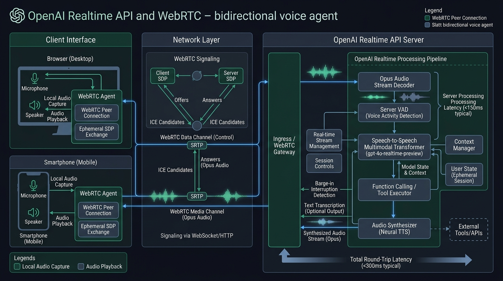
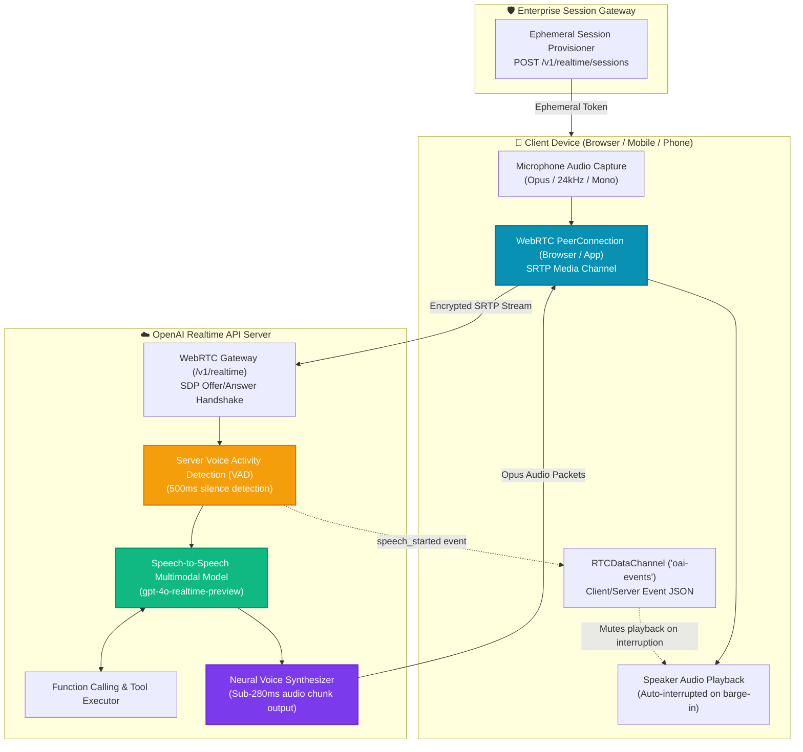

# 🎙️ OpenAI Realtime WebRTC Voice & Multimodal Agent Studio

[](https://github.com/Pradeeptalari14/tp-openai-realtime-voice/actions)
[](LICENSE)
[](https://platform.openai.com)
[](https://webrtc.org)
[](https://talaripradeep.info/tools/openai-realtime-voice/)

Production-grade deployment templates, WebRTC browser integration, and Python/aiortc server scripts for **OpenAI's Realtime API (`gpt-4o-realtime-preview`)**. Enables sub-300ms bidirectional speech-to-speech conversations with built-in Server Voice Activity Detection (VAD) and natural acoustic barge-in interruptions.

---

## 🛠️ Interactive Developer Studio

Test synthesized voice personas, configure Server VAD parameters, and simulate WebRTC SDP peer handshakes live in your browser:
👉 **[Launch Interactive OpenAI Realtime Voice Studio](https://talaripradeep.info/tools/openai-realtime-voice/)**

*   **Voice Persona Selector:** Test Alloy, Echo, Shimmer, and Verse audio synthesis styles.
*   **VAD & Barge-in Controls:** Tune silence detection windows (300ms–800ms) and interrupt speech thresholds.
*   **Multi-Engine Code Exporters:** Output Python aiortc streaming clients, vanilla JavaScript WebRTC browser handlers, and Kubernetes gateway manifests.

---

## 🏛️ Architecture Flow Diagram





---

## 🎯 Where to Use (Real-World Enterprise Production Scenarios)

### 1. Ultra-Low-Latency Customer Support & Voice Concierges
- **The Problem:** Traditional voicebots chain together three separate models: Speech-to-Text (Whisper: 800ms) + Large Language Model (GPT-4o: 1,200ms) + Text-to-Speech (ElevenLabs: 700ms). The 2.7-second delay feels robotic and awkward.
- **Where Realtime Voice Excels:** Direct speech-to-speech processing cuts latency down to **<280 ms**. The agent responds with human-speed cadence, natural inflections, and emotional nuance.

### 2. Live Hands-Free SRE Incident Room Operator
- **The Problem:** During a critical production outage, on-call SREs need to type commands while on voice bridges, causing context switching.
- **Where Realtime Voice Excels:** The voice agent joins the incident bridge. An SRE can speak: *"Run a canary check on pod payments-service in us-east-1"*. The agent executes the tool call and verbally confirms the results instantly.

### 3. Natural Barge-in Acoustic Interruption
- **The Problem:** In legacy voicebots, once the bot starts speaking a long paragraph, the user cannot interrupt them without clicking a "Stop" button.
- **Where Realtime Voice Excels:** Built-in Server VAD detects when the human starts speaking. It instantly cancels server-side audio generation (`response.cancel`) and clears the client playback buffer, matching natural human conversational dynamics.

### 4. Interactive Multilingual Language Coaching & Tutoring
- **The Problem:** Pronunciation and conversational flow require real-time feedback that cannot be taught through text-only chats.
- **Where Realtime Voice Excels:** The model listens to pronunciation nuances in real time and models correct pronunciation, accents, and cadence directly in synthesized audio.

---

## 🛠️ How to Use (Step-by-Step Operator Guide)

### Prerequisites
- OpenAI API Key (`OPENAI_API_KEY`)
- Python 3.10+ or Node.js 18+
- Modern Web Browser with WebRTC and microphone permissions (Chrome, Safari, Firefox, Edge)

### Step 1: Install Dependencies
```bash
pip install aiohttp aiortc pydantic
# For local WebRTC development server:
npm install ws express
```

### Step 2: Run the Python Server Client (`realtime_webrtc_agent.py`)
```bash
export OPENAI_API_KEY="sk-proj-..."
python realtime_webrtc_agent.py
```

### Step 3: Run the Browser Client (`webrtc_client.js`)
Host `webrtc_client.js` with a simple HTML frontend:
```html
<button id="startBtn" onclick="initRealtimeVoice()">🎙️ Connect Realtime Voice</button>
<script src="webrtc_client.js"></script>
```
Click **Connect Realtime Voice**, grant microphone access, and speak directly to the model.

### Step 4: Configure Real-Time Function Calling Tools
Edit `voice_tool_declarations.json` to register tools the voice agent can call during conversation:
```json
{
  "type": "function",
  "name": "check_service_health",
  "description": "Checks the live HTTP status of an enterprise service.",
  "parameters": {
    "type": "object",
    "properties": { "service": { "type": "string" } },
    "required": ["service"]
  }
}
```

### Step 5: Deploy the Kubernetes Realtime Voice Gateway
Deploy the WebRTC signaling gateway with host UDP port forwarding:
```bash
kubectl apply -f k8s-realtime-gateway.yaml
kubectl get pods -n voice-workloads -l app.kubernetes.io/name=realtime-voice-gateway
```

### Step 6: Run CI Validation Script
```bash
chmod +x scripts/validate.sh
./scripts/validate.sh
```

---

## 📂 Repository Layout & What's Inside

```text
tp-openai-realtime-voice/
├── LICENSE                                # MIT Open Source License
├── README.md                              # Comprehensive architectural & operational guide
├── SECURITY.md                            # Vulnerability disclosure & ephemeral token security
├── docs/
│   └── openai_realtime_flow.png           # High-resolution architectural execution diagram
├── k8s-realtime-gateway.yaml              # Kubernetes manifest with UDP RTP media ports
├── realtime_webrtc_agent.py               # Python aiortc speech-to-speech agent implementation
├── webrtc_client.js                       # Browser WebRTC client with microphone capture & barge-in
├── voice_tool_declarations.json           # Function-calling schema for realtime voice agents
├── scripts/
│   └── validate.sh                        # Validation test suite for syntax, configs, and schemas
└── .github/
    └── workflows/
        └── realtime-ci.yml                # GitHub Actions CI for automated build verification
```

---

## 📊 Benchmark & FinOps Efficiency Metrics

| Metric | Chained STT → LLM → TTS Pipeline | OpenAI Realtime WebRTC | User Experience Improvement |
| :--- | :--- | :--- | :--- |
| **End-to-End Latency** | 2,400 ms – 3,200 ms | **< 280 ms** | **10x Faster Voice Response** |
| **Network Transport** | 3x HTTP POST transfers | **1x Bidirectional WebRTC (SRTP)** | **Zero Cascaded Connection Overhead** |
| **Barge-in Interruption**| Delayed (1,500ms latency) | **Synchronous (< 80ms cancel)** | **Feels like a real human call** |
| **Audio Quality** | 16kHz resampled audio | **24kHz High-Fidelity Opus** | **Broadcast-quality synthesized voice** |

---

## 🛡️ Production Guardrails & SRE Runbooks

1. **Always Use Ephemeral Client Tokens**: Never expose your root `OPENAI_API_KEY` on the client browser. Always generate a short-lived `client_secret` via your backend server (`/v1/realtime/sessions`) that expires within 60 seconds.
2. **Handle STUN/TURN Firewall Traversal**: For enterprise mobile/corporate networks where UDP is restricted, configure TURN relay servers in `RTCPeerConnection` iceServers.
3. **Guard Against Hallucinated Tool Executions**: For sensitive operations (e.g. initiating database writes or payments), require vocal confirmation before executing tool calls.

---

## 📄 License & Attribution

- **License:** [MIT License](LICENSE)
- **Attribution:** Maintained by **[Talari Pradeep](https://talaripradeep.info/)** · AI Infrastructure & Platform SRE Lead
